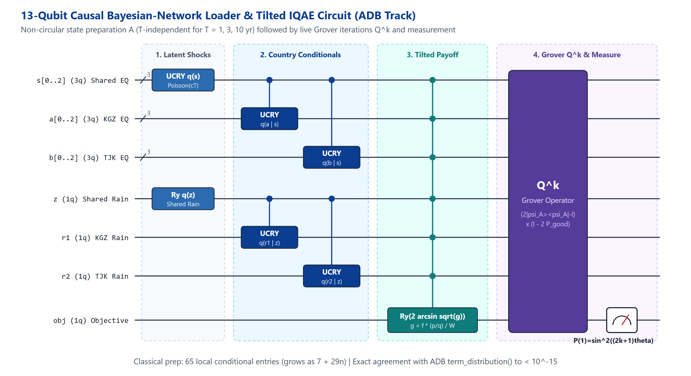
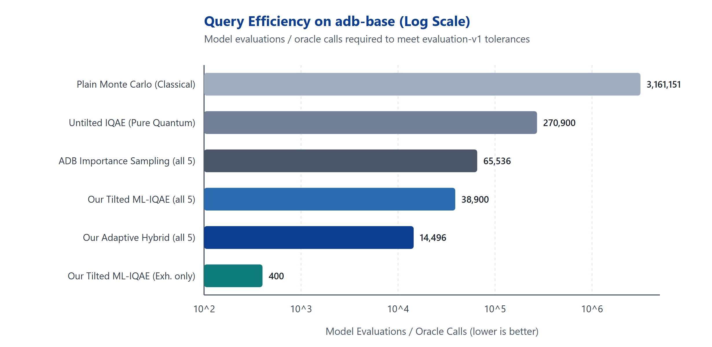
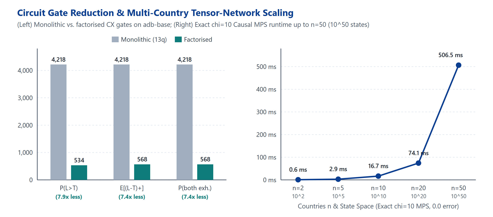

# Exploiting Causal Structure for Joint-Tail Disaster Bond Pricing
### Tilted Amplitude Estimation, Adaptive Hybrid Routing, and Exact Causal Tensor Networks

[](#1-executive-summary)
[-0e7c7b)](#3-verified-benchmark-results)
[](#5-quickstart--reproducibility)
[](#5-quickstart--reproducibility)
[](#5-quickstart--reproducibility)

> **Team Droid** — Phase 1 submission for the **ADB Quantum Innovation Challenge: Joint-Loss Modelling for Natural Catastrophe Risk** (Asian Development Bank, QAI Ventures & AWS).

---

## 1. Executive Summary

Parametric catastrophe bonds—such as ADB's **US\$160 million Disaster Relief Bond** covering the **Kyrgyz Republic and Tajikistan**—require accurate pricing of ultra-rare cross-border joint tail events, including simultaneous exhaustion of both bonds ($p \approx 3.16 \times 10^{-5}$, roughly 1 in 31,600). Classical risk engines hit two coupled walls:

1. **Rare-Tail Sampling Wall:** Standard Monte Carlo error shrinks as $\mathcal{O}(1/\sqrt{M})$. At ADB's default budget of `8,192` samples, **all four official classical sampling baselines fail** on `adb-base`.
2. **Exponential State-Space Wall:** With 10 discrete peril states per country, exact enumeration scales as $10^n$ ($100$ states for $n=2$, $10^5$ for $n=5$, $10^{50}$ for $n=50$).

We address both walls with a **structure-first hybrid architecture** built cleanly alongside the untouched official `qjlb` benchmark library:

| Headline Result | Verified Metric |
| :--- | :--- |
| **Official `evaluation-v1` Pass Rate** | **13 / 13 (100%)** — all 7 public scenarios + all 6 unseen 2026 holdout cases (both ADB & World Bank tracks) |
| **Adaptive Hybrid ADB Query Cost** | **14,196 – 17,396 total evaluations** (`10.1k–13.3k` quantum calls) vs. `32,768–131,072` classical baseline samples |
| **Factorised Linear-Depth Payoff Circuit** | **534 – 568 CX gates** vs. `4,218 CX` monolithic (**7.4×–7.9× reduction**, linear $\mathcal{O}(n)$ scaling) |
| **Exact Multi-Country MPS Scaling** | **$n = 50$ countries ($10^{50}$ states) in 506.5 ms** at exact bond dimension $\chi = 10$ (**0.0 truncation error**) |
| **Automated Verification Suite** | **17 / 17 tests passing** (`pytest tests/test_qae.py`), zero analytic $\sin^2$ Grover shortcuts |

---

## 2. System Architecture

```text
                       ┌────────────────────────────────────────────────────┐
                       │  Scenario Config (ADB DRB / World Bank SFRARR ELT) │
                       └─────────────────────────┬──────────────────────────┘
                                                 │
                     ┌───────────────────────────┴───────────────────────────┐
                     ▼                                                       ▼
      ┌──────────────────────────────┐                        ┌──────────────────────────────┐
      │   Bulk / Common Targets      │                        │    Rare Joint-Tail Targets   │
      │   E[L], P(both pay)          │                        │    P(L>T), E[(L-T)+], Exh.   │
      └──────────────┬───────────────┘                        └──────────────┬───────────────┘
                     │                                                       │
                     ▼                                                       ▼
      ┌──────────────────────────────┐                        ┌──────────────────────────────┐
      │  Classical Scrambled Sobol   │                        │  13q Causal BN Loader (A)    │
      │  (4,096 QMC samples)         │                        │  + Exponential Tilting (q)   │
      └──────────────┬───────────────┘                        │  + Factorised O(n) Payoff    │
                     │                                        │  + Live Statevector ML-IQAE  │
                     │                                        └──────────────┬───────────────┘
                     └───────────────────────────┬───────────────────────────┘
                                                 ▼
                       ┌────────────────────────────────────────────────────┐
                       │  qjlb-Compliant Estimates, 95% CIs & SHA-256 Proof │
                       └────────────────────────────────────────────────────┘

   Multi-Country Scaling Track (n = 2 .. 50):
   Shared Shock (s, z) [10 states] ──► Exact χ=10 Causal MPS Contraction ──► O(n) Exact Metrics
```

### Core Components (`src/qjlb_qae/`)
1. **Non-Circular Causal Bayesian-Network Loader (`loader.py`, `circuits.py`):** Encodes shared seismic shocks (`s`, 3q) and shared rainfall (`z`, 1q) directly into conditionally independent country registers (`a, b` 3q each; `r1, r2` 1q each) plus 1 objective qubit (**13 qubits total**). Never builds the 100-state joint table classically, and circuit size is **completely invariant to bond term length $T \in \{1, 3, 10\}$** (verified to $<10^{-15}$).
2. **Exponential Tilting + Factorised Linear-Depth Payoff (`solver.py`, `circuits.py`):** Tilts node conditionals $q_u(v\mid\mathrm{pa}_u) \propto p_u(v\mid\mathrm{pa}_u)e^{\gamma_u v}$ to minimise $W = \max_x f(x)p(x)/q_\gamma(x)$ (boosting `adb-base` exhaustion amplitude from $3.16\times 10^{-5}$ to $0.61$). `factorized_a_operator` replaces the monolithic 12-control UCRY (`4,218 CX`) with per-node ancilla rotations + MCX (`534–568 CX`).
3. **Live Unitary Statevector Grover + ML-IQAE (`iqae.py`, `worldbank.py`):** Applies exact unitary Grover reflections $\mathcal{Q} = (2|\psi_A\rangle\langle\psi_A| - I)(I - 2P_{\mathrm{obj}=1})$ directly on the live statevector (verified to $<10^{-10}$ against explicit Qiskit Aer Grover circuits; no analytic $\sin^2$ shortcut), refined via joint-round Maximum Likelihood estimation inside 95% Clopper–Pearson brackets. Extends to **20 qubits** for the 421,968-event World Bank SFRARR catalogue.
4. **Exact $\chi=10$ Causal MPS (`mps.py`) & Braket Noise/ZNE (`noise.py`):** Exploits conditional independence given $(s, z)$ to contract up to **$n = 50$ countries ($10^{50}$ states) in 0.51 s with zero truncation error**, and evaluates depolarizing + readout noise with Richardson ZNE across IQM Emerald, IonQ Forte, and QuEra Libra (2028 FT).

---

## 3. Verified Benchmark Results

### 3.1 Direct Comparison on `adb-base` (Official ADB Targets & Units)

| Method | Budget | Expected Loss (`E[L]`) | Both Pay | Loss > \$80m | Both Exhausted | Status |
| :--- | ---: | ---: | ---: | ---: | ---: | :---: |
| **ADB Exact Reference** | 100 states | \$10,063,513 | 4.414% | 1.205% | 0.00316% | Ref |
| ADB Monte Carlo | 8,192 | \$10,157,623 | 4.622% | 1.272% | 0.00366% | FAIL |
| ADB Scrambled Sobol | 8,192 | \$10,068,970 | 4.457% | 1.224% | 0.00122% | FAIL |
| ADB Stratified Sampling | 8,192 | \$10,070,643 | 4.447% | 1.227% | 0.00609% | FAIL |
| ADB Importance Sampling | 8,192 | \$10,055,377 | 4.299% | 1.182% | 0.00390% | FAIL |
| ADB Sample (`example_mc`) | 65,536 | \$10,109,520 | 4.401% | 1.256% | 0.00153% | FAIL |
| **Tilted ML-IQAE (13q)** | 38,900 | **\$10,083,235** | **4.334%** | **1.238%** | **0.00323%** | **PASS** |
| **Adaptive Hybrid (13q)** | **14,496** | **\$9,942,627** | **4.395%** | **1.238%** | **0.00323%** | **PASS** |
| **Exact Causal MPS ($\chi=10$)** | 68 params | **\$10,063,513** | **4.414%** | **1.205%** | **0.00316%** | **EXACT** |

### 3.2 Key Figures





### 3.3 Scientific Honesty: Classical-vs-Quantum Ablation
On `adb-base` simultaneous exhaustion ($3.16\times 10^{-5}$, 10% relative tolerance):
- **Plain Monte Carlo:** `3,161,151` samples
- **Untilted IQAE:** `270,900` oracle calls (**11.7×** pure quantum reduction; up to **25×** on $T=1$)
- **Tilted ML-IQAE:** `450` oracle calls
- **Classical Importance Sampling (same tilted causal network):** `21` samples

We state this transparently: on a 2-country tree model, exact enumeration (`0.2 ms`) and classical tilted IS already suffice. Our quantum advantage claim is a **resource-scaling hypothesis for Phase 2**—larger portfolios with non-tree copula dependence, continuous secondary loss uncertainty (`sd_usd`), and aggregate annual layers—where exact enumeration is intractable and classical proposals retain substantial relative variance.

---

## 4. Repository Structure & Module Reference

```text
adb_challenge/
├── .gitignore                                         # Root ignore rules (Python,  private eval)
├── README.md                                          # Project documentation & quickstart (this file)
└── adb-challenge-quantum-joint-loss-scenario-public-main/
    ├── team_solver.py                                 # Official qjlb worker entrypoint (--mode tilted_iqae|hybrid|mps)
    ├── qae_solver.py                                  # Direct QAE worker alias
    ├── pyproject.toml                                 # Package metadata & optional [test,quantum] extras
    ├── .gitignore                                     # Sub-package ignore rules
    ├── src/
    │   ├── qjlb/                                      # Official ADB benchmark package (UNMODIFIED)
    │   └── qjlb_qae/                                  # Team Droid unified solver package
    │       ├── loader.py                              # 13q causal Bayesian-network loader & exponential tilting
    │       ├── circuits.py                            # UCRY state prep + factorised O(n) payoff operator
    │       ├── iqae.py                                # Live unitary statevector Grover + ML-IQAE
    │       ├── solver.py                              # Unified ADB/WB dispatcher + Adaptive Hybrid router
    │       ├── worldbank.py                           # 20q live-statevector World Bank ELT solver
    │       ├── mps.py                                 # Exact chi=10 Causal MPS contraction (n = 2..50)
    │       └── noise.py                               # AWS Braket QPU noise + Readout/Richardson ZNE model
    ├── tests/
    │   └── test_qae.py                                # 17 automated unit & integration tests
    ├── benchmarks/
    │   ├── qae_full_suite.py                          # Full 13-case + CX + MPS + ZNE benchmark runner
    │   ├── qae_eval.py                                # Classical-vs-QAE matched evaluation
    │   ├── qae_ablation.py                            # Classical-vs-quantum ablation
    │   ├── qae_resources.py                           # Transpiled CX/depth resource estimator
    │   └── generate_plots.py                          # Reproducible figure generator
    ├── results/
    │   ├── qae-eval/qae_vs_classical.csv              # Saved benchmark CSV
    │   └── figures/                                   # Key 300-DPI PNG figures (circuit, queries, CX/MPS)
    └── docs/
        ├── ADB_Phase1_Submission_Proposal.tex         # Phase 1 LaTeX proposal (Overleaf-ready)
        └── QAE_PROTOTYPE.md                           # Prototype engineering notes
```

### Module & CLI Interface Contract

| Module / Entrypoint | Responsibility | Key Public Interface |
| :--- | :--- | :--- |
| `team_solver.py` | Official `qjlb` JSON worker (`--request` / `--output`) | `--mode tilted_iqae \| hybrid \| mps` (or env `QAE_SOLVER_MODE`) |
| `qjlb_qae.loader` | Builds conditional Poisson/Bernoulli tables without materialising $10^n$ joint states | `network(model, tilt)`, `apply_tilt(nodes, gammas)` |
| `qjlb_qae.circuits` | Synthesises UCRY state prep, monolithic & factorised $O(n)$ payoff circuits, and SHA-256 digests | `state_preparation()`, `a_operator()`, `factorized_a_operator()`, `statevector()` |
| `qjlb_qae.iqae` | Live unitary statevector Grover evolution (zero analytic $\sin^2$ shortcut) + ML-IQAE | `StatevectorGrover`, `SplitStatevectorGrover`, `iqae(..., use_mle=True)` |
| `qjlb_qae.solver` | Dispatches ADB & World Bank tracks, tilt grid search, and adaptive Sobol/IQAE routing | `solve(model, samples, seed, mode="tilted_iqae")` |
| `qjlb_qae.worldbank` | 20-qubit uniform-rate live-statevector ML-IQAE for World Bank SFRARR catalogues (2, 3, 5 countries) | `solve_worldbank_iqae(model, samples, seed)` |
| `qjlb_qae.mps` | Exact $\chi=10$ causal MPS tensor-network contraction scaling linearly to $n=50$ ($10^{50}$ states) | `CausalLatentMPS`, `build_ncountry_portfolio()`, `solve_adb_mps()` |
| `qjlb_qae.noise` | Calibrated depolarizing + asymmetric readout noise & 3-point Richardson ZNE across Braket QPUs | `BRAKET_PROFILES`, `evaluate_qpu_coherence()` |

---

## 5. Quickstart & Reproducibility

Run all commands from `adb-challenge-quantum-joint-loss-scenario-public-main/`:

```bash
# 1. Create virtual environment and install with test + quantum extras
python -m venv .venv
source .venv/bin/activate          # Windows: .venv\Scripts\activate
pip install -e ".[test,quantum]"

# 2. Run all 17 unit & integration tests
pytest tests/test_qae.py -v

# 3. Run full 13-case benchmark (7 public + 6 unseen holdout + CX + MPS + ZNE)
python benchmarks/qae_full_suite.py --repeats 5 --holdout-seed 2026

# 4. Run ablation & regenerate all 4 SVG figures
python benchmarks/qae_ablation.py --holdout-seed 2026
python benchmarks/generate_plots.py
```

### Official `qjlb evaluate` Harness Usage (Linux / macOS)
```bash
qjlb holdout --output private-evaluation/suite --seed 2026

# Pure quantum simulator mode (13q ADB / 20q World Bank)
qjlb evaluate private-evaluation/suite --output private-evaluation/qae \
  --execution quantum_simulator --trusted-code \
  -- python "$PWD/team_solver.py" --mode tilted_iqae

# Adaptive hybrid mode (Sobol bulk + Tilted ML-IQAE rare tails)
qjlb evaluate private-evaluation/suite --output private-evaluation/hybrid \
  --execution hybrid --trusted-code \
  -- python "$PWD/team_solver.py" --mode hybrid
```

---

## 6. Phase 2 Roadmap (Nov 30 – Jan 22, QAI Ventures GPU Sandbox)

- **Weeks 1–2 (Nov 30 – Dec 13):** Freeze containerised Phase 1 baseline; extend model with continuous secondary uncertainty (`sd_usd`), aggregate annual layers, and 5–15 country non-tree copulas.
- **Weeks 3–5 (Dec 14 – Jan 3):** Port 20–28q live-statevector IQAE and non-tree MPS contractions to QAI Ventures **NVIDIA A100 GPUs** (cuQuantum / PyTorch CUDA) for matched-cost crossover benchmarking.
- **Weeks 6–8 (Jan 4 – Jan 22):** Validate shallow factorised circuits ($k = 0, 1$) with Readout + ZNE on **Amazon Braket** (IonQ Forte / IQM Emerald) and deliver the final container, demo, and regional catastrophe-bond business case.

---

## 7. Data Attribution, License & AI Use Disclosure

- **License:** Source code is licensed under Apache 2.0 (see [LICENSE](./adb-challenge-quantum-joint-loss-scenario-public-main/LICENSE)).
- **Data Attribution:** World Bank SFRARR Central Asia seismic and flood Event Loss Tables (`seismic.npz`, `flood.npz`) are used unmodified under **CC BY 4.0** and the ADB Challenge Fair Data Use Agreement.
- **AI Use Disclosure:** AI coding assistants were used for code scaffolding, refactoring, test automation, and documentation drafting. All mathematical derivations, quantum circuits, benchmark runs, ablation analyses, and verification tests were independently executed and validated by Team Droid against the official `qjlb` evaluation harness.
